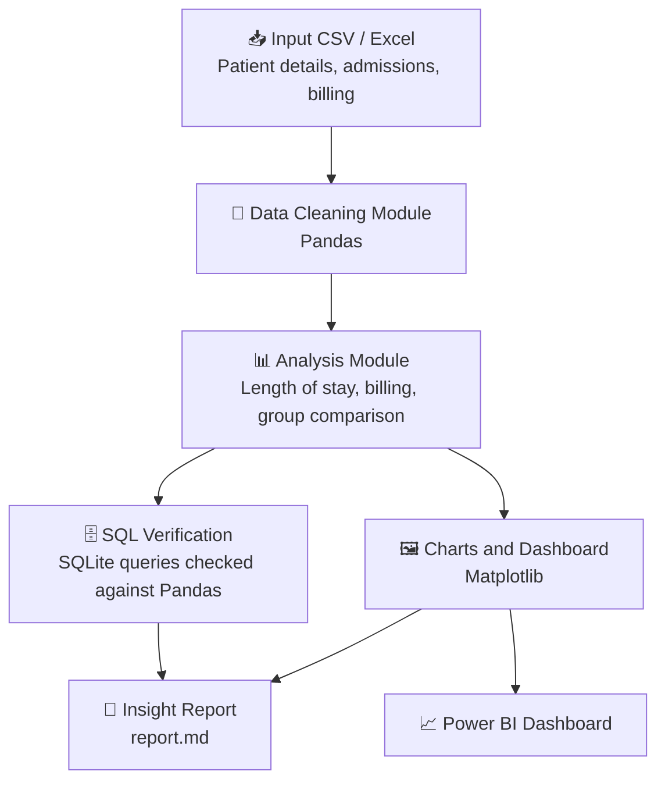

<div align="center">

# 🏥 Hospital Patient Data Analyzer

**An automated Python pipeline that turns a raw hospital admissions file into a cleaned dataset, SQL-verified insights, charts, a one-page dashboard and a manager's report, in a single command.**


</div>

---

## 📊 Dashboard Preview

<div align="center">
  
</div>

---

## 📌 Table of Contents
1. [Overview](#-overview)
2. [Key Results](#-key-results)
3. [Features](#-features)
4. [Pipeline](#-pipeline)
5. [Dataset](#-dataset)
6. [Data Cleaning](#-data-cleaning)
7. [Visual Analysis](#-visual-analysis)
8. [SQL Analysis](#-sql-analysis)
9. [Installation & Usage](#-installation--usage)
10. [Project Structure](#-project-structure)
11. [Power BI Dashboard](#-power-bi-dashboard)
12. [Limitations](#-limitations)
13. [Future Scope](#-future-scope)

---

## 🔎 Overview

Hospitals collect a large amount of admission data, but reading it by hand is slow and mistakes are easy. Analysing it step by step in a notebook also means repeating the same work every time a new file arrives.

The **Hospital Patient Data Analyzer** automates this. The user gives it a patient admissions CSV file, and the tool:

- cleans the data and logs every fix,
- calculates length of stay, billing and group summaries,
- answers business questions with SQL and cross-checks the answers with Pandas,
- draws charts and a one-page dashboard,
- writes a findings report with recommendations.

---

## 🎯 Key Results

| Metric | Value |
|---|---|
| Patient admissions analysed | **54,860** (after cleaning) |
| Period covered | 2019-05-08 to 2024-05-07 |
| Average age | **51.5 years** |
| Average length of stay | **15.5 days** |
| Average billing per admission | **$25,595** |
| Total billing | **$1.40 billion** |
| Highest-billing condition | **Obesity** ($25,859 average) |
| Lowest-billing condition | **Cancer** ($25,206 average) |
| Insurer with largest total billing | **Cigna** ($284.3M) |
| High-cost flag (top 5% of bills) | above **$47,641** (2,743 patients) |
| Long-stay flag (top 5% of stays) | **29 days** or more (3,691 patients) |

> The differences between groups are small because the dataset is synthetic. See [Limitations](#-limitations).

---

## ✨ Features

| Feature | What it does |
|---|---|
| 🧹 **Automatic cleaning** | Fixes name casing, removes duplicates and invalid billing, converts dates, and prints a cleaning log |
| 📅 **Feature engineering** | Adds Length of Stay, Age Group, Billing Per Day, Admission Year and Month |
| 📈 **Group analysis** | Compares patients by condition, admission type, insurer, age group, gender and medication |
| 🚩 **Risk flags** | Marks the top 5% most expensive and top 5% longest-stay patients |
| 🗄️ **SQL layer** | Loads data into SQLite and runs 5 queries |
| ✅ **Self-verification** | Cross-checks SQL answers against Pandas results |
| 🖼️ **Charts and dashboard** | Saves 9 charts and a one-page dashboard as PNG files |
| 📝 **Auto report** | Writes `report.md` with findings and recommendations |
| 🔁 **Reusable** | Works on any file that has the same 15 columns |

---

## 🔄 Pipeline



---

## 📂 Dataset

**Healthcare Dataset** (public, Kaggle): 55,500 rows and 15 columns.

| Column | Description |
|---|---|
| Name, Age, Gender, Blood Type | Patient details |
| Medical Condition | Arthritis, Asthma, Cancer, Diabetes, Hypertension, Obesity |
| Date of Admission, Discharge Date | Stay period |
| Admission Type | Elective, Urgent, Emergency |
| Insurance Provider | Aetna, Blue Cross, Cigna, Medicare, UnitedHealthcare |
| Billing Amount | Cost of the admission ($) |
| Medication | Aspirin, Ibuprofen, Lipitor, Paracetamol, Penicillin |
| Test Results | Normal, Abnormal, Inconclusive |
| Doctor, Hospital, Room Number | Other details |

---

## 🧹 Data Cleaning

| Problem found | Fix applied | Rows affected |
|---|---|---|
| Duplicate records | Removed | **534** |
| Negative billing amounts | Removed as invalid | **106** |
| Names in random casing (`LesLie TErRy`) | Converted to normal casing (`Leslie Terry`) | All rows |
| Dates stored as text | Converted to real dates | All rows |
| Missing values | Checked (none left) | 0 |
| Discharge before admission | Checked (none found) | 0 |

**Result:** 55,500 rows became **54,860 clean rows**.
**New columns added:** `Length of Stay`, `Age Group`, `Billing Per Day`, `Admission Year`, `Admission Month`.

---

## 📉 Visual Analysis

<table>
<tr>
<td width="50%"></td>
<td width="50%"></td>
</tr>
<tr>
<td align="center"><b>Average billing by medical condition</b></td>
<td align="center"><b>Total billing by insurance provider</b></td>
</tr>
<tr>
<td width="50%"></td>
<td width="50%"></td>
</tr>
<tr>
<td align="center"><b>Admission type comparison</b></td>
<td align="center"><b>Test results by medical condition</b></td>
</tr>
<tr>
<td width="50%"></td>
<td width="50%"></td>
</tr>
<tr>
<td align="center"><b>Patients and billing by age group</b></td>
<td align="center"><b>Distribution of length of stay</b></td>
</tr>
<tr>
<td width="50%"></td>
<td width="50%"></td>
</tr>
<tr>
<td align="center"><b>Monthly admissions</b></td>
<td align="center"><b>Correlation matrix</b></td>
</tr>
</table>

### What the charts show
- **Billing by condition:** Obesity is highest and Cancer lowest, but the whole range is only about 2.6%.
- **Admission types:** Elective, Urgent and Emergency admissions are almost equal in number (18,437 / 18,353 / 18,070).
- **Test results:** Abnormal, Normal and Inconclusive are each close to one third.
- **Correlation:** billing has almost no link with age (0.00) or length of stay (−0.01).
- **Age group:** the under-18 group has the highest abnormal share (40.5%), but it has only 116 patients, so it should not be over-read.

---

## 🗄️ SQL Analysis

The cleaned data is loaded into a SQLite table named `patients`. Example query:

```sql
SELECT "Medical Condition"              AS condition,
       COUNT(*)                         AS patients,
       ROUND(AVG("Billing Amount"), 2)  AS avg_billing,
       ROUND(AVG("Length of Stay"), 2)  AS avg_stay
FROM patients
GROUP BY "Medical Condition"
ORDER BY avg_billing DESC;
```

| Query | Question answered |
|---|---|
| Q1 | Patients, average billing and stay by medical condition |
| Q2 | Total billing by insurance provider |
| Q3 | Patients, billing and stay by admission type |
| Q4 | Abnormal test share by age group |
| Q5 | Top 10 most expensive admissions |

All queries are saved in `outputs/queries.sql`. Queries Q1 to Q3 are automatically **cross-checked against Pandas** on every run, and all three match.

---

## ⚙️ Installation & Usage

**1. Install the libraries**
```bash
pip install -r requirements.txt
```

**2. Run the analyzer**
```bash
python analyzer.py
```

**3. Use your own file (optional)**
```bash
python analyzer.py my_file.csv my_output_folder
```

**Sample console output (shortened)**
```
[1/6] Loading data ...             55,500 rows, 15 columns
[2/6] Cleaning data ...            duplicates_removed: 534, negative_billing_removed: 106
[3/6] Analysing ...
[4/6] Running SQL queries ...      Q1 OK, Q2 OK, Q3 OK
[5/6] Drawing charts and dashboard ...
[6/6] Writing report ...
Done. Results are in: outputs
```

**Requirements:** Python 3.9 or higher, plus `pandas`, `matplotlib` and `tabulate`. SQLite comes built into Python.

---

## 🗂️ Project Structure

```
hospital_analyzer/
│
├── analyzer.py                  # Main pipeline (load, clean, analyse, SQL, charts, report)
├── requirements.txt             # Python libraries
├── README.md                    # This file
├── POWERBI_GUIDE.md             # DAX measures and dashboard layout
│
├── data/
│   └── healthcare_dataset.csv   # Raw input data
│
└── outputs/
    ├── cleaned_healthcare.csv   # Cleaned data (also used in Power BI)
    ├── dashboard.png            # One-page dashboard
    ├── report.md                # Findings and recommendations
    ├── queries.sql              # SQL queries
    ├── hospital.db              # SQLite database
    ├── charts/                  # 9 individual charts
    └── tables/                  # 22 summary tables (CSV)
```

---

## 📊 Power BI Dashboard

`POWERBI_GUIDE.md` explains how to build an interactive dashboard from `outputs/cleaned_healthcare.csv`:

- 4 KPI cards (patients, average age, average stay, average billing)
- bar, column, donut and line charts for the main comparisons
- slicers for condition, admission type, insurer, gender and year
- ready-to-use DAX measures such as `Avg Billing` and `Abnormal %`

---

## ⚠️ Limitations

- The dataset is **synthetic**, so the findings show how the tool works. They are **not real medical conclusions**.
- Group differences are small, and billing shows almost no correlation with age or length of stay.
- The under-18 group has only 116 patients, so its results are not reliable.
- The `Hospital` and `Doctor` columns have almost as many unique values as rows, so they are not used for group comparisons.
- The tool describes the data. It does not predict anything yet.

---

## 🚀 Future Scope

- Add a machine learning model to predict length of stay or billing amount.
- Build a web interface (Streamlit) where the user can upload a file and see the dashboard.
- Add automatic PDF report export.
- Add readmission analysis if the data includes repeat visits.
- Test the tool on real, anonymised hospital data.

---

<div align="center">

**Built with Python 🐍 · Pandas · Matplotlib · SQLite · Power BI**

*Minor Project: Data Analytics Internship Report*

</div>
